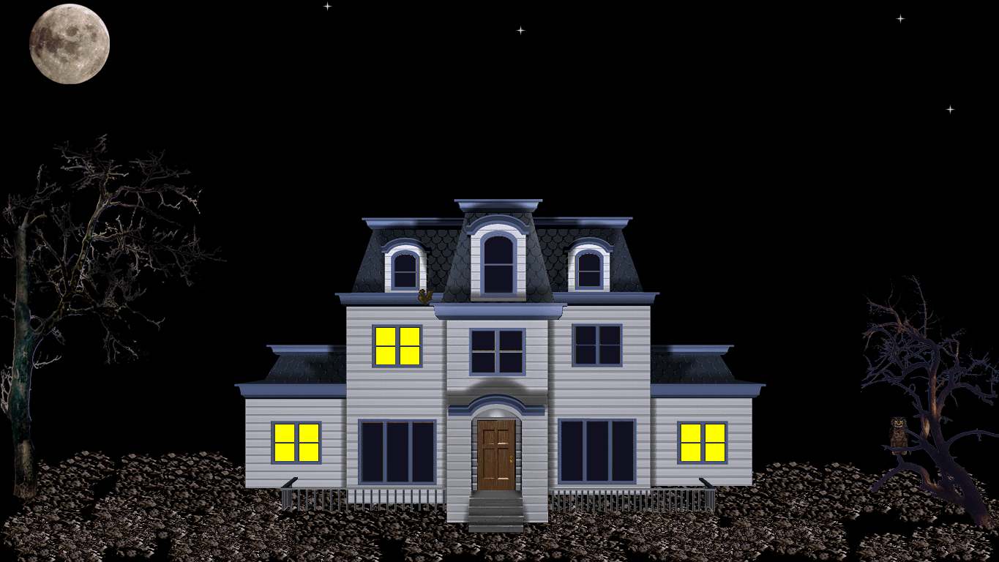
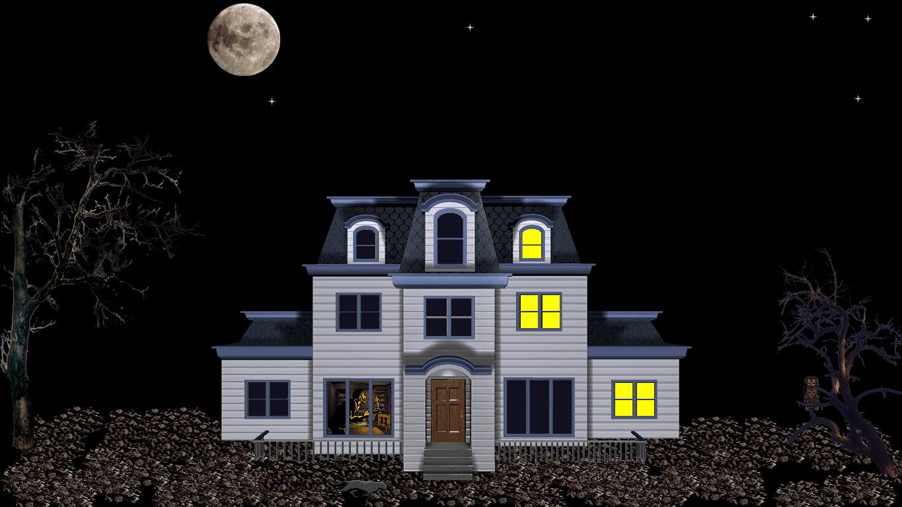
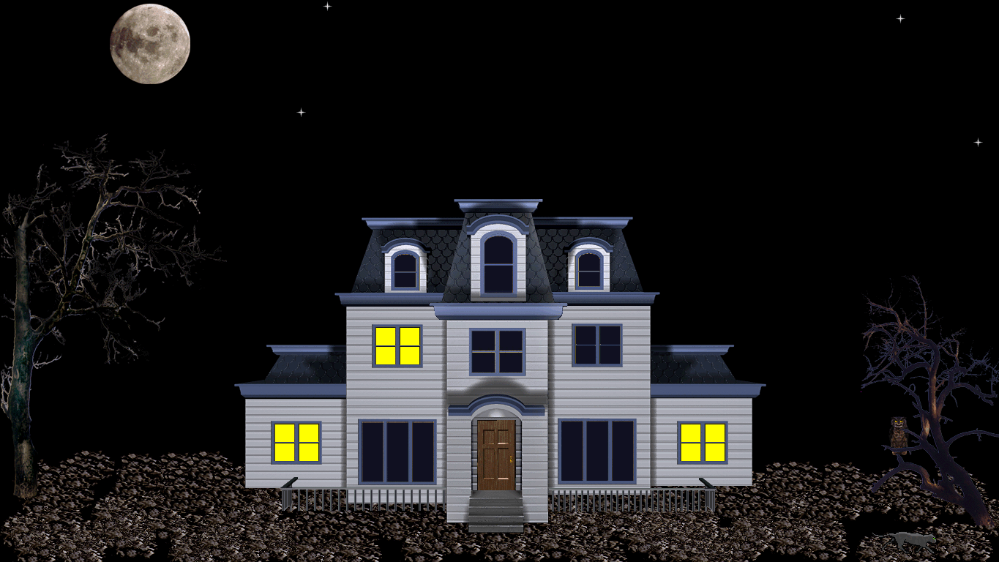
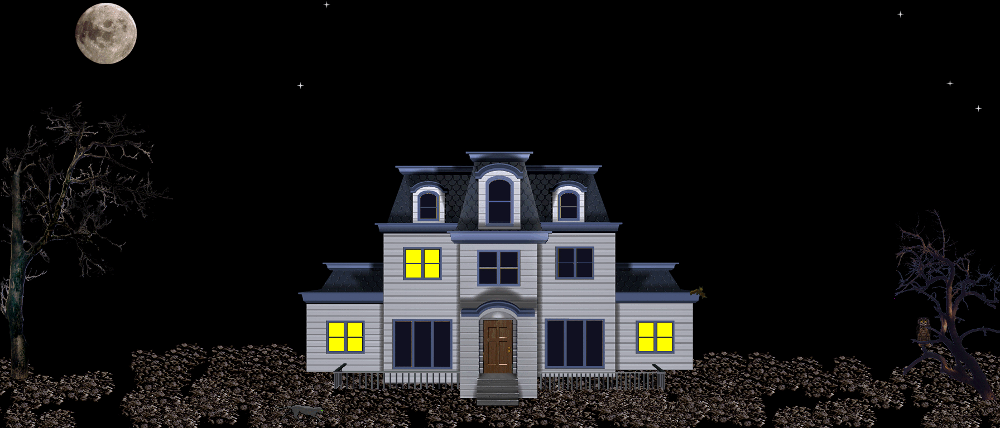
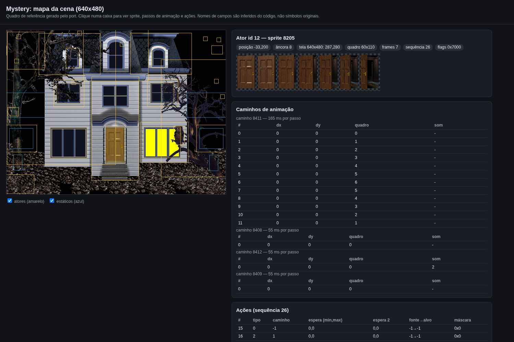

# mystery-sdl

An unofficial **SDL2 / Linux port of the "Mystery" screen saver** from *Microsoft Plus! for Windows 95* (haunted house, lit windows, owl, bats, a black cat, a creaking door, a howling moon...), including a **`--wide` mode** that fills modern 16:9 and ultrawide screens without black bars.



<p>


</p>



*(Screenshots are of this port running with the original game data, in `--wide` mode at 1365x768 and 1792x768. See [Legal](#legal).)*

---

## ⚠️ Disclaimer: this is 100% AI "vibe code"

**All of the code, tooling and documentation in this repository was written entirely by an AI (Claude, by Anthropic, driven through Claude Code)**, under the direction of the repository owner, who steered it with plain-language requests and tested the result by eye on their own desktop. No human wrote or line-by-line reviewed this code. It has not been audited, it has had no formal testing beyond the checks described below, and it may contain bugs, memory-safety problems or wrong assumptions. **Use it at your own risk**, do not trust it with anything important, and read the code before you run it if that matters to you.

It is **not affiliated with, endorsed by, or approved by Microsoft Corporation or Socha Computing, Inc.**

## What it is

The original saver is a thin `Mystery.scr` stub that loads the *Wildlife* engine (`WL32DLL.DLL`, by Socha Computing), which in turn loads the plugin `Mystery.dll`. The plugin is an actor/sprite state machine driven by data tables, plus the artwork and sounds as PE resources.

This port re-implements the engine's host services (sprites, per-sprite animation paths, sound) and transliterates the plugin's logic to C, then **reads your own copy of `Mystery.dll` at run time** for the data tables, sprites (PKWARE-DCL compressed 8-bit bitmaps, magenta colour key) and sounds. Nothing from the original is embedded in this repository.

Validation, for what it is worth: the first frame was compared pixel-for-pixel against the original `.scr` running under Wine at 640x480 (about 0.05% of pixels differed: the moon, which moves, and the owl's eyes), and the owner confirmed on a real desktop that the cat appears, sounds play and the animation timing looks right. Timing details of individual animations are *not* verified against the original beyond that.

## You need the original `Mystery.dll`

Not included, and I won't tell you where to find it: take it from your own legitimately obtained copy of *Microsoft Plus! for Windows 95*. The port expects exactly this file (a wrong file is rejected by a table-size check):

```
SHA-256  27c9e51912cf88bbdb3c44cbba35900280a4d3d808f4b59112975dd7f592d98a  Mystery.dll
```

Verify with the included checksum file (run it in the folder that contains `Mystery.dll`):

```sh
sha256sum -c /path/to/mystery-sdl/SHA256SUMS
```

## Build and run

### Prerequisites

* A **C compiler** (`gcc` or `clang`), **`make`** and **`pkg-config`**.
* **SDL2 development files** (SDL 2.0.5 or newer; `sdl2-compat` also works). Audio and video come from SDL, so a working SDL audio backend is needed unless you run with `--mute`.
* The original **`Mystery.dll`**, see the [previous section](#you-need-the-original-mysterydll).
* Optional, only for the [scene viewer](#scene-viewer-optional): Python 3, ImageMagick (`magick`) and a web browser.

Install the build tools and SDL2:

| distro | command |
| --- | --- |
| Arch / CachyOS | `sudo pacman -S base-devel pkgconf sdl2-compat` (`sdl2` on older installs) |
| Debian / Ubuntu | `sudo apt install build-essential pkg-config libsdl2-dev` |
| Fedora | `sudo dnf install gcc make pkgconf-pkg-config SDL2-devel` |

Only Arch Linux on x86-64 (with `sdl2-compat` 2.32) has been tested; the other lines are the usual package names and were not tried.

### Build

```sh
git clone https://github.com/viny182/mystery-sdl.git
cd mystery-sdl
make            # produces ./mystery  (a single C file, no other dependencies)
```

`make clean` removes the binary. You can pass your own compiler flags, for example `make CFLAGS="-O2 -g"`.

### Run

```sh
./mystery --dll /path/to/Mystery.dll --wide     # fullscreen, fills your screen
```

Any key press, mouse click, or mouse movement of more than 4 px exits (windowed mode ignores mouse movement). If `Mystery.dll` is in the current directory you can omit `--dll`. Common problems:

* `cannot open ...`: wrong path to `Mystery.dll`.
* `unexpected table sizes (wrong Mystery.dll?)` or `unexpected Mystery.dll image base`: the file is not the expected one; check its [SHA-256](#you-need-the-original-mysterydll).
* No sound or an audio error: try `--mute`, or check that SDL can open an audio device.

### Options

| option | meaning |
| --- | --- |
| `--dll PATH` | path to `Mystery.dll` (default `./Mystery.dll`) |
| `--wide` | **not in the original**: logical area gets your screen's aspect ratio (768 tall, e.g. 1365x768 on 16:9), stars are spread across the width and the ground rubble is repeated on very wide screens |
| `--logical WxH` | fullscreen logical size (default `1024x768`, aspect-preserving, letterboxed); `--logical native` renders at screen resolution with an automatic integer scale |
| `--size WxH` | windowed instead of fullscreen |
| `--scale N` | integer scale for native-resolution rendering |
| `--mute` | no sound |
| `--seed N` | fixed random seed for the actors' timing choices (see [About `--seed`](#about---seed)) |
| `--fast --dump MS out.bmp` | headless: simulate `MS` milliseconds with a fake clock and save the frame (use `SDL_VIDEODRIVER=dummy`) |

### About `--seed`

The scene uses a small pseudo-random generator (the same linear congruential generator as the MSVC C runtime's `rand()`, as in the original). `--seed N` sets the starting value of that generator for the **actors**, so it decides every random choice they make:

* **how long each actor waits** before its next action, drawn between the minimum and maximum stored in the scene tables (for example: how long until the next window lights up, when the door opens, when the cat shows up);
* **how many times** a looping animation repeats before it stops.

What it does **not** change: the sprites, sounds and positions of the house, trees, moon path and stars, and the layout of the ground rubble. The rubble is placed with a fixed seed (1), exactly as the original does at start-up, so the ground looks the same in every run. In my check, two runs with different seeds produced identical first frames, and after two simulated minutes they differed only in where a few actors happened to be.

Without `--seed`, the generator is seeded from the clock, so every run plays out differently, which is the normal "screen saver" behaviour. With a fixed seed you get the same sequence of random draws. In a real-time run that makes runs similar but **not guaranteed identical**, because the draws happen when events fire, and that depends on your frame timing. In the headless mode (`--fast --dump`, which uses a fake clock) the same seed always gives exactly the same frame, which is what makes it useful for reproducible screenshots and bug reports. It does not affect speed, difficulty or anything else; there is nothing to "win".

The original offered 640x480, 800x600, 1024x768, 1280x1024 or full screen, and never scaled the art: it was designed for at most 1280x1024, with the ground rubble and stars defined around the screen centre. That is why a plain fullscreen run on a 1440p monitor looks sparse, and why `--wide` exists.

## Scene viewer (optional)

`tools/dump_scene.py` dumps the decoded scene tables to `scene.json` and builds a self-contained `viewer.html` (click an actor to see its sprite strip, animation steps and actions). The output embeds the original sprites, so keep it local.



*(The viewer's own UI text is in Portuguese.)*

```sh
python3 tools/dump_scene.py /path/to/Mystery.dll tools/out   # needs ./mystery built and ImageMagick
xdg-open tools/out/viewer.html
```

## How it was reverse engineered, and what turned up

The original binaries were analysed with **[REA: Reverse Engineer Anything](https://github.com/morluto/rea)**, an MCP server that gives AI agents decompilation, cross-references, resource inspection and more (here through its Ghidra backend), driven by Claude. Where the decompiler output was unclear, `objdump` disassembly settled it, and at the end the original `.scr` was run under Wine to compare against this port. It is all static analysis of files the author owns; nothing was patched or redistributed.

The main findings:

1. **The `.scr` is almost empty.** It is a 38 KB stub that parses the usual saver switches (`/s` run, `/c` configure, `/p` preview, `/a` change password) and hands everything to other DLLs. Its strings (`Sage.DLL`, `PASSWORD.CPL`, `MPR.DLL`) are Plus!/Windows 9x glue (System Agent detection, password check/change), irrelevant for a port.
2. **Three layers.** `Mystery.scr` loads the *Wildlife* engine `WL32DLL.DLL` (MFC-based, Socha Computing), which loads a plugin **named after the `.scr`**: `Mystery.scr` becomes `Mystery.dll`, whose internal name is still `TEST.dll`. The plugin exports `Initialize`, `DoDraw` and `Close` (the host also looks for an optional `DoEvent`, which this plugin does not have). `WILDLB32.DLL` only contains input hooks for idle detection.
3. **The plugin is a tiny data-driven scripting engine.** The scene is 26 background stamps, 34 actors and about 80 actions grouped into per-actor sequences. Actors wait random times, move, change state, and wake each other up through bit-mask triggers and sprite-rectangle overlap tests.
4. **The host passes the plugin 22 function pointers** in a static table (create sprite, move, tick animation, hide, destroy, play sound...). The plugin has no imports for them: it calls them by table slot, so the table had to be found by following where the host calls `Initialize`.
5. **Sprites are PKWARE DCL ("implode") streams.** Resource type 261 is a 32-bit uncompressed size followed by a DCL stream; the first bytes `00 06` (binary mode, 4 KB dictionary) gave it away. The decompressed sizes matched the stored sizes exactly, and the result is a plain 8-bit BMP with **magenta (255,0,255) as the transparent colour key**. Frames of an animation are laid out side by side in one strip.
6. **A three-step resource chain describes each sprite:** type 256 (sprite definition) points to 257 (bitmap descriptor: bitmap id, colour key, frame count), and the definition lists type 300 resources, the animation *paths* (a step interval in ms, then steps of `dx, dy, frame, sound id`). The host also supports types 258 and 262 (alternative path and sound formats) that this plugin never uses.
7. **Timing is in units of 55 ms**, and a few things are deliberately rare. By the tables, the black cat waits a fixed 90 s before its first appearance and then 0 to 90 s between visits; the door opens every 50 to 70 s; only four animation paths carry a sound (door, moon, owl and one small sprite).
8. **The random numbers are the MSVC C runtime's `rand()`** (the multiplier `214013` and increment `2531011` are visible in the disassembly). The ground rubble is placed with a fixed seed, so it looks the same on every run; only the actors' timing is random.
9. **The scene was designed for at most 1280x1024.** The host has a table of window sizes (full screen, 640x480, 800x600, 1024x768, 1280x1024) and never scales the art. Ground rubble and stars are defined around the screen centre, which is why plain fullscreen on a modern monitor looks sparse and why this port has `--wide`.
10. **Decompiler traps.** Ghidra matched a tiny field accessor to an MFC library function name (`CSplitterWnd::IsTracking`), hiding that it really returns a field; and it dropped two arguments of a five-argument call in the screen-edge wrap code. Reading the disassembly fixed both. Lesson: sanity-check any decompiled call whose arguments do not add up.
11. **No easter eggs were found** in the strings, the version info or the scene tables (this is not an exhaustive search).

## Not ported

The registry settings and password dialog, the System Agent / hot-corner hooks, the preview mode (`/p`) and the original's config dialog.

## Legal

* The source code in this repository is released under the [MIT License](LICENSE).
* *Microsoft Plus!*, the *Mystery* screen saver, its artwork and sounds belong to Microsoft Corporation and/or their respective authors. The *Wildlife* engine belongs to Socha Computing, Inc. This repository contains **none** of their files or data. The screenshots above show their artwork as produced by this program and are included for illustration only; if you are a rights holder and want them removed, open an issue and they will be.
* The behaviour of the original was studied by static analysis of the binaries (disassembly/decompilation) for interoperability; this is a re-implementation, not a copy of the original code. If reverse engineering is restricted where you live, check your local law before using or modifying this project.
* The PKWARE DCL decompressor follows the well-known public algorithm as implemented in zlib's `contrib/blast` by Mark Adler (zlib license); the decoder here is derived from that algorithm and its code tables, rewritten in this file.
* Uses [SDL2](https://libsdl.org) (zlib license).
* The reverse engineering was done with [REA](https://github.com/morluto/rea) (MIT).
